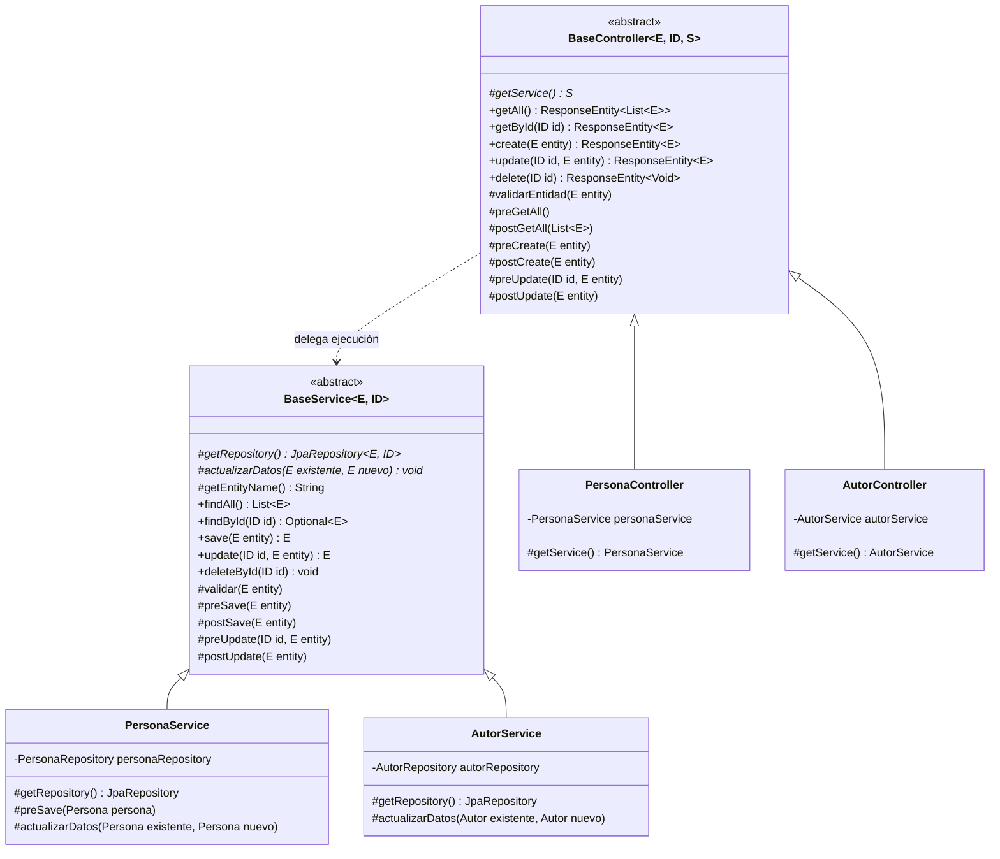

# TP2 - Ejercicio 3 (c): Patrón Template Method en Controladores y Servicios REST

Este proyecto implementa la refactorización solicitada en el **Ejercicio 3, inciso c)** del Trabajo Práctico Guía N°2 de Ingeniería del Software II (UTN FRM), basada en el sistema de biblioteca de los ejercicios anteriores.

---

## 🎯 Objetivo de la Refactorización

Refactorizar la arquitectura del backend para desacoplar y estandarizar la lógica CRUD aplicando el **patrón de diseño de comportamiento Template Method (Método Plantilla)** en conjunto con **Java Generics**, introduciendo:

1. **`BaseService<E, ID>`**: Clase abstracta de servicio que define el esqueleto algorítmico invariable para las operaciones de negocio CRUD (`findAll`, `findById`, `save`, `update`, `deleteById`), delegando pasos primitivos obligatorios (`getRepository`, `actualizarDatos`) y métodos gancho u hooks (`preSave`, `postSave`, `preUpdate`, `validar`, etc.) a los servicios específicos.
2. **`BaseController<E, ID, S>`**: Clase abstracta de controlador REST que encapsula la estructura de endpoints HTTP (`@GetMapping`, `@PostMapping`, `@PutMapping`, `@DeleteMapping`), la coordinación con el servicio, la respuesta HTTP (`200 OK`, `201 CREATED`, `404 NOT FOUND`, `204 NO CONTENT`) y hooks de ciclo de vida web.

---

## 📐 Diagrama de Clases del Patrón Template Method



---

## 🏛️ Componentes Refactorizados

| Entidad | Controlador Concreto | Servicio Concreto | Particularidades delegadas al Template Method |
| :--- | :--- | :--- | :--- |
| **Persona** | `PersonaController` | `PersonaService` | En `preSave` asocia Domicilio y Libros administrados. En `actualizarDatos` mapea datos personales, email, nacimiento y colecciones. |
| **Libro** | `LibroController` | `LibroService` | En `preSave` asocia lista de autores gestionados. En `actualizarDatos` mapea título, páginas, género, autores y fecha de vencimiento. |
| **Autor** | `AutorController` | `AutorService` | En `actualizarDatos` mapea nombre, apellido y biografía. |
| **Domicilio** | `DomicilioController` | `DomicilioService` | En `preSave` asocia Localidad foránea. En `actualizarDatos` mapea calle, número, coordenadas lat/lng y localidad. |
| **Localidad** | `LocalidadController` | `LocalidadService` | En `actualizarDatos` mapea la denominación. |

---

## 🚀 Funcionalidades Heredadas Mantenidas

1. **Automatización & Scheduling (2.c)**:
   - Recordatorios de vencimiento de préstamos (24 horas antes) automáticos por `@Scheduled` y disparables manualmente.
   - Salutación de cumpleaños con HTML embebido y botón a UTN FRM.
   - Historial de notificaciones en base de datos SQLite y visor en modal.
2. **Geolocalización & Google Maps (2.b)**:
   - Coordenadas de latitud y longitud en domicilios con enlaces directos a Google Maps.
3. **Frontend Interactivo**:
   - Interfaz web Vanilla JS con pestañas completas para personas, libros, autores, localidades, domicilios y notificaciones.

---

## 🛠️ Cómo Ejecutar el Proyecto

### 1. Iniciar el Servidor Backend (Puerto 8080)
```bash
cd servidor
./mvnw spring-boot:run
```

### 2. Iniciar el Cliente Web Frontend (Puerto 8081)
```bash
cd cliente
./mvnw spring-boot:run
```
Abrir el navegador en `http://localhost:8081`.
