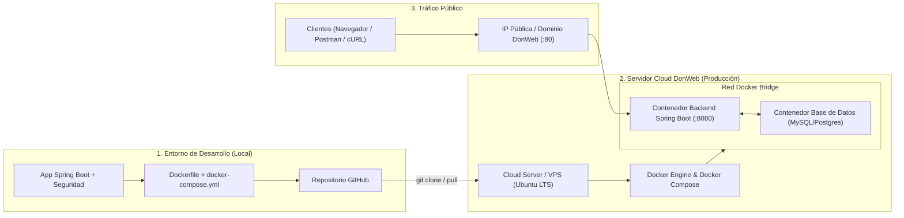

# 🚀 Guía de Despliegue en Producción con DonWeb y Docker

## TP2 - Ejercicio N°6 Inciso d) | Ingeniería del Software II

Este documento detalla el paso a paso para implementar la puesta en marcha en producción de la aplicación del **Trabajo Práctico Integrador N°1 con Seguridad** (Spring Boot + Spring Security / JWT + Base de Datos), utilizando los servicios de hosting de **DonWeb** mediante contenedores **Docker**.

---

## 🎯 Objetivo de la Actividad

Desplegar la aplicación en un servidor real accesible vía Internet a través de una dirección IP pública o nombre de dominio, validando el funcionamiento de la persistencia de datos y de los mecanismos de seguridad (tokens JWT / endpoints protegidos).

---

## 🏗️ Arquitectura del Despliegue



---

## 📝 FASE 1: Preparación del Proyecto en Local

Antes de subir al servidor remoto, la aplicación debe prepararse para desacoplar credenciales sensibles y operar dentro de contenedores.

### 1.1 Configurar variables de entorno en Spring Boot

En `src/main/resources/application.properties` (o en un perfil `application-prod.properties`), reemplaza credenciales fijas por variables de entorno con valores por defecto:

```properties
# Puerto de escucha del contenedor
server.port=8080

# Conexión a Base de Datos (ejemplo MySQL en contenedor)
spring.datasource.url=jdbc:mysql://${DB_HOST:localhost}:${DB_PORT:3306}/${DB_NAME:gatinder_db}?createDatabaseIfNotExist=true&useSSL=false&allowPublicKeyRetrieval=true
spring.datasource.username=${DB_USER:root}
spring.datasource.password=${DB_PASSWORD:root}
spring.jpa.hibernate.ddl-auto=update

# Seguridad / JWT
jwt.secret=${JWT_SECRET:claveSecretaSuperSeguraParaProduccion1234567890}
jwt.expiration=${JWT_EXPIRATION:86400000}
```

---

### 1.2 Crear el archivo `Dockerfile`

En la raíz del proyecto backend crea el archivo `Dockerfile` optimizado:

```dockerfile
# ==========================================================
# Etapa 1: Compilación del código fuente con Maven
# ==========================================================
FROM maven:3.9-eclipse-temurin-17-alpine AS builder
WORKDIR /app
COPY pom.xml .
RUN mvn dependency:go-offline -B
COPY src ./src
RUN mvn clean package -DskipTests

# ==========================================================
# Etapa 2: Imagen liviana de ejecución (JRE 17)
# ==========================================================
FROM eclipse-temurin:17-jre-alpine
WORKDIR /app
COPY --from=builder /app/target/*.jar app.jar

# Variables de entorno para optimizar memoria en contenedores
ENV JAVA_OPTS="-XX:+UseContainerSupport -XX:MaxRAMPercentage=75.0 -Djava.security.egd=file:/dev/./urandom"

EXPOSE 8080
ENTRYPOINT ["sh", "-c", "java $JAVA_OPTS -jar app.jar"]
```

---

### 1.3 Crear el archivo `docker-compose.yml`

En la raíz del proyecto crea el archivo `docker-compose.yml` para orquestar la aplicación y su base de datos:

```yaml
version: '3.8'

services:
  database:
    image: mysql:8.0
    container_name: db_produccion
    restart: always
    environment:
      MYSQL_DATABASE: gatinder_db
      MYSQL_ROOT_PASSWORD: ${DB_ROOT_PASSWORD}
    volumes:
      - mysql_data:/var/lib/mysql
    networks:
      - app-network

  app:
    build: .
    container_name: backend_produccion
    restart: always
    ports:
      - "80:8080" # Mapea el puerto 80 HTTP externo al 8080 de Spring Boot
    environment:
      - DB_HOST=database
      - DB_PORT=3306
      - DB_NAME=gatinder_db
      - DB_USER=root
      - DB_PASSWORD=${DB_ROOT_PASSWORD}
      - JWT_SECRET=${JWT_SECRET}
    depends_on:
      - database
    networks:
      - app-network

volumes:
  mysql_data:
    name: produccion_mysql_data

networks:
  app-network:
    driver: bridge
```

---

### 1.4 Subir los cambios a GitHub

```bash
git add .
git commit -m "feat: dockerizacion y configuracion para DonWeb"
git push origin main
```

---

## 🌐 FASE 2: Aprovisionamiento del Servidor en DonWeb

1. **Acceder a DonWeb**:
   - Ingresa a [https://donweb.com/es-ar/](https://donweb.com/es-ar/) e inicia sesión.
2. **Contratar Cloud Server (VPS)**:
   - Dirígete a la sección **Cloud Servers** (o Servidores VPS).
   - Selecciona un plan con al menos **2 GB de RAM** (recomendado para Spring Boot + MySQL).
3. **Parámetros del Servidor**:
   - **Sistema Operativo**: **Ubuntu 22.04 LTS** (o Debian).
   - **Zona / Data Center**: Argentina o más cercano.
   - **Seguridad**: Configura la contraseña del usuario `root` o carga tu clave SSH pública.
4. **Obtención de Credenciales**:
   - En el panel de control de DonWeb copia la **IP Pública** asignada (ejemplo: `181.xxx.xxx.xxx`) y confirma que el estado sea **Activo**.

---

## 💻 FASE 3: Conexión y Configuración del Servidor Remoto

### 3.1 Conexión SSH al servidor de DonWeb

Abre tu terminal local (PowerShell, Bash o CMD) y conéctate:

```bash
ssh root@<IP_PUBLICA_DONWEB>
```
*(Ingresa la contraseña de `root` cuando sea solicitada)*.

---

### 3.2 Actualizar el sistema e instalar utilitarios

```bash
apt update && apt upgrade -y
apt install -y git curl ufw
```

---

### 3.3 Instalar Docker y Docker Compose

Ejecuta el script oficial de instalación de Docker:

```bash
curl -fsSL https://get.docker.com | sh
```

Habilita y arranca el servicio:

```bash
systemctl enable docker
systemctl start docker
docker --version
docker compose version
```

---

### 3.4 Configurar el Firewall (UFW)

Abre solo los puertos requeridos:

```bash
ufw allow OpenSSH   # Puerto 22 (SSH)
ufw allow 80/tcp    # Puerto HTTP público
ufw allow 443/tcp   # Puerto HTTPS (opcional)
ufw --force enable
ufw status
```

---

## 🚀 FASE 4: Despliegue de la Aplicación en DonWeb

### 4.1 Clonar el repositorio en el servidor

```bash
mkdir -p /opt/app && cd /opt/app
git clone https://github.com/<tu-organizacion-o-usuario>/<tu-repositorio>.git .
```

---

### 4.2 Inyectar las variables seguras de producción

Crea el archivo `.env` en `/opt/app` en el servidor:

```bash
nano .env
```

Pega los valores de producción:

```env
DB_ROOT_PASSWORD=SuperPasswordProduccion2026!
JWT_SECRET=ClaveSecretaDeProduccionParaFirmarJwtDeAlMenos256Bits1234567890
```
*(Para guardar en `nano`: presiona `Ctrl + O`, luego `Enter` y sal con `Ctrl + X`)*.

---

### 4.3 Construir y levantar los contenedores

```bash
docker compose up -d --build
```

---

### 4.4 Validar la ejecución

1. **Comprobar contenedores activos**:

   ```bash
   docker compose ps
   ```

   *(Ambos contenedores `db_produccion` y `backend_produccion` deben figurar en estado `Up`)*.

2. **Verificar los logs de Spring Boot en tiempo real**:

   ```bash
   docker logs -f backend_produccion
   ```

   *(Verifica que aparezca `Tomcat started on port 8080 (http)` y `Started Application in X seconds`)*.
   *(Para salir del log presiona `Ctrl + C`)*.

---

## 🧪 FASE 5: Pruebas y Validación Pública

### 5.1 Prueba de Acceso Público

Desde tu navegador o Postman en tu computadora local:

1. **Prueba de Endpoint Abierto / Salud**:

   ```bash
   curl http://<IP_PUBLICA_DONWEB>/api/public/ping
   ```

2. **Prueba de Autenticación (Spring Security / JWT)**:

   ```bash
   curl -X POST http://<IP_PUBLICA_DONWEB>/api/auth/login \
     -H "Content-Type: application/json" \
     -d '{
       "username": "admin",
       "password": "passwordSegura123"
     }'
   ```

   *(Deberás recibir el token JWT en la respuesta)*.

3. **Prueba de Endpoint Protegido con Token**:

   ```bash
   curl -X GET http://<IP_PUBLICA_DONWEB>/api/privado/datos \
     -H "Authorization: Bearer <TOKEN_OBTENIDO>"
   ```

---
