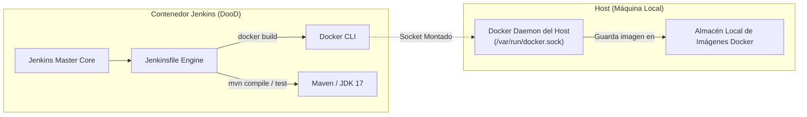
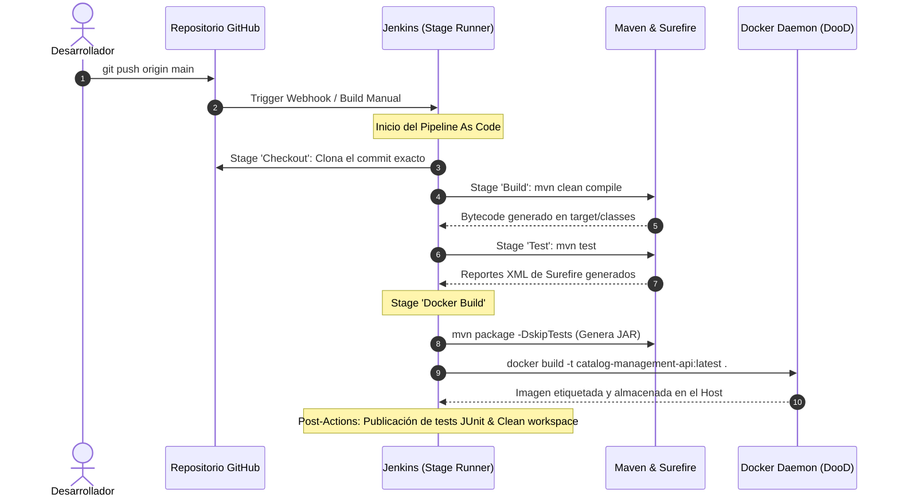

# 🚀 Guía de CI/CD con Jenkins, Docker (DooD) y Spring Boot


---

## 📌 1. Arquitectura y Enfoque DooD (Docker-outside-of-Docker)

Este proyecto implementa un entorno de Integración y Entrega Continua (**CI/CD**) completamente reproducible en local. Jenkins corre como un contenedor Docker y utiliza el patrón **Docker-outside-of-Docker (DooD)**:



### ¿Por qué DooD y no DinD (Docker-in-Docker)?
- **Docker-outside-of-Docker (DooD)**: Monta el socket Unix `/var/run/docker.sock` del host dentro del contenedor de Jenkins. El cliente Docker dentro de Jenkins se comunica directamente con el daemon de Docker del host.
  - **Ventajas**: Evita contenedores anidados con privilegios inseguros (`--privileged`), aprovecha la caché de capas de Docker del host acelerando los builds drásticamente, y las imágenes construidas quedan disponibles inmediatamente en el sistema local.
- **Docker-in-Docker (DinD)**: Ejecuta un daemon de Docker completo dentro de otro contenedor. Requiere privilegios de root del kernel y suele generar problemas de corrupción de storage drivers y lentitud.

---

## 🐳 2. Despliegue de Jenkins

Para garantizar reproducibilidad tanto en Linux/macOS como en Windows (Docker Desktop), tienes dos métodos equivalentes:

### Opción A: Despliegue con Docker Compose (Recomendada)
Dentro de la carpeta `ProyectoPipelineDocker`:

```bash
docker compose up -d --build
```
> Esta opción utiliza el archivo `Dockerfile.jenkins` para compilar una imagen derivada de `jenkins/jenkins:lts-jdk17` que incluye automáticamente el cliente **Docker CLI** y **Maven**, configurando el usuario con los permisos de socket requeridos.

---

### Opción B: Despliegue con Comando Directo `docker run`

Ejecuta el siguiente comando en tu terminal:

#### En Linux / macOS / Git Bash:
```bash
docker run -d \
  --name jenkins \
  --restart unless-stopped \
  -u root \
  -p 8080:8080 \
  -p 50000:50000 \
  -v jenkins_home:/var/jenkins_home \
  -v /var/run/docker.sock:/var/run/docker.sock \
  jenkins/jenkins:lts-jdk17
```

#### En Windows (PowerShell):
```powershell
docker run -d `
  --name jenkins `
  --restart unless-stopped `
  -u root `
  -p 8080:8080 `
  -p 50000:50000 `
  -v jenkins_home:/var/jenkins_home `
  -v //var/run/docker.sock:/var/run/docker.sock `
  jenkins/jenkins:lts-jdk17
```

> **Nota para la Opción B**: Dado que la imagen base oficial `jenkins/jenkins:lts-jdk17` no incluye el cliente Docker preinstalado, tras levantar el contenedor ejecuta el siguiente comando una sola vez para instalar la herramienta CLI de Docker dentro de Jenkins:
> ```bash
> docker exec -u root jenkins sh -c "apt-get update && apt-get install -y docker.io maven"
> ```

---

## 🔑 3. Configuración Inicial de Jenkins (Paso a Paso)

### Paso 3.1: Obtención del password de administrador inicial
Abre tu navegador en: [http://localhost:8080](http://localhost:8080).

Jenkins solicitará la clave inicial de desbloqueo. Obténla con el siguiente comando en tu terminal:

```bash
docker exec jenkins cat /var/jenkins_home/secrets/initialAdminPassword
```
*(Si usaste docker compose, el contenedor se llama `jenkins-dood`)*:
```bash
docker exec jenkins-dood cat /var/jenkins_home/secrets/initialAdminPassword
```

Copia la cadena alfanumérica mostrada, pégala en el campo **Administrator password** y presiona **Continue**.

---

### Paso 3.2: Instalación de Plugins Requeridos
1. En la pantalla de bienvenida, selecciona **"Install suggested plugins"** para configurar el conjunto básico.
2. Una vez completada la instalación básica y creado el usuario administrador, dirígete a:
   - **Administrar Jenkins (Manage Jenkins)** ➔ **Plugins** ➔ pestaña **Available plugins**.
3. En la barra de búsqueda busca e instala los siguientes plugins indispensables:
   - **Pipeline**: Suite completa para definición de flujos como código (`Jenkinsfile`).
   - **Maven Integration**: Soporte nativo para proyectos y reportes Maven.
   - **Docker Pipeline**: Permite interactuar con Docker desde scripts de Pipeline y ejecutar agentes dentro de contenedores.
4. Marca la casilla **"Restart Jenkins when installation is complete"** (o reinicia manualmente el contenedor).

---

### Paso 3.3: Configuración de Herramientas Globales (Tools)
Dirígete a: **Administrar Jenkins** ➔ **Tools** (Herramientas Globales):

1. **Sección JDK**:
   - Haz clic en **Add JDK**.
   - **Name**: `jdk-17`
   - Puedes desmarcar "Install automatically" e indicar `JAVA_HOME: /opt/java/openjdk` (ruta donde la imagen base de Jenkins aloja Java 17).
2. **Sección Maven**:
   - Haz clic en **Add Maven**.
   - **Name**: `maven-3`
   - Marca **Install automatically** (versión `3.9.x`) o define `MAVEN_HOME: /usr/share/maven` si instalaste Maven a nivel de contenedor.
3. Haz clic en **Save**.

---

## 🛠️ 4. Creación del Pipeline Job en Jenkins

1. En el panel principal de Jenkins, haz clic en **Nueva Tarea (New Item)**.
2. Ingresa un nombre: `catalog-management-pipeline`.
3. Selecciona el tipo **Pipeline** y presiona **OK**.
4. En la pestaña de configuración del Pipeline:
   - Desplázate hasta la sección **Pipeline**.
   - En **Definition**, selecciona **Pipeline script from SCM**.
   - En **SCM**, elige **Git**.
   - En **Repository URL**, ingresa la URL de tu repositorio (local o GitHub).
   - En **Branch Specifier**, coloca `*/main`.
   - En **Script Path**, escribe: `ProyectoPipelineDocker/Jenkinsfile` (o `Jenkinsfile` si el repositorio apunta directamente a la raíz de la carpeta).
5. Haz clic en **Guardar (Save)**.
6. Haz clic en **Construir ahora (Build Now)** para disparar la primera ejecución.

---

## 🔄 5. ¿Cómo funciona el Flujo de CI/CD?

El ciclo de vida del software desde el código fuente hasta la imagen lista para producción se ejecuta mediante el [`Jenkinsfile`](file:///c:/Users/Lucho/Desktop/KMP-IS-II-MLJ-/TP2/Ejercicio6/ProyectoPipelineDocker/Jenkinsfile) estructurado en 4 etapas declarativas:



### Detalle de cada Stage:

1. **`stage('Checkout')`**:
   Descarga de forma determinista la versión del código correspondiente al commit desencadenante desde el control de versiones Git.

2. **`stage('Build')`**:
   Ejecuta `mvn clean compile`. Valida que las dependencias declaradas en el `pom.xml` se resuelvan sin conflictos y compila las clases Java en bytecode.

3. **`stage('Test')`**:
   Ejecuta `mvn test`. Corre la batería completa de pruebas unitarias y de integración (`BookServiceTest`, `BookControllerTest`, `CatalogManagementApplicationTests`). Publica automáticamente el reporte visual mediante el paso `junit '**/target/surefire-reports/*.xml'`. Si una sola prueba falla, el pipeline se detiene inmediatamente (*fail-fast*).

4. **`stage('Docker Build')`**:
   - Genera el archivo ejecutable final mediante `mvn package -DskipTests`.
   - Invoca el daemon de Docker a través del socket montado para construir la imagen según las directivas del [`Dockerfile`](file:///c:/Users/Lucho/Desktop/KMP-IS-II-MLJ-/TP2/Ejercicio6/ProyectoPipelineDocker/Dockerfile).
   - Genera dos etiquetas: la versión vinculada al número de build (`catalog-management-api:${BUILD_NUMBER}`) y la etiqueta fija `catalog-management-api:latest`.

---

## 📊 6. Verificación de Stages y Monitoreo

### 1. Visualización de Etapas (Stage View)
En la vista principal del trabajo en Jenkins verás una tabla cronológica que detalla el estado de cada etapa:
- 🟩 **Verde**: Etapa exitosa.
- 🟥 **Rojo**: Etapa fallida.
- ⏳ **Azul**: Etapa en ejecución activa.

Haciendo clic sobre cualquier bloque de color puedes seleccionar **"Logs"** para inspeccionar la salida detallada de esa etapa puntual sin tener que buscar en el log general.

### 2. Verificar la Imagen Docker en el Host
Abre una terminal en tu máquina física y verifica que la imagen construida por Jenkins existe en tu daemon local:

```bash
docker images | grep catalog-management-api
```

### 3. Probar el Contenedor Creado
Inicia la aplicación construida por el pipeline:

```bash
docker run -d --name test-catalog -p 8081:8080 catalog-management-api:latest
```

Valida el endpoint de la API:
```bash
curl http://localhost:8081/api/books
```

Para detener y limpiar la prueba:
```bash
docker rm -f test-catalog
```

---

## ⚠️ 7. Solución de Problemas Comunes (Troubleshooting)

### Error 1: Permisos del Socket de Docker (`permission denied`)
**Síntoma:**
```text
dial unix /var/run/docker.sock: connect: permission denied
```
**Causa:**
El usuario `jenkins` (UID 1000) dentro del contenedor no tiene permisos de lectura/escritura sobre el socket `/var/run/docker.sock`, que pertenece al usuario `root` o al grupo `docker` del host.

**Soluciones:**
- **Solución Rápida (Entornos locales/desarrollo):** Ejecutar el contenedor con el flag `-u root` o `--user root` (incluido por defecto en nuestras instrucciones de arriba).
- **Ajustar permisos del socket directamente en caliente:**
  ```bash
  docker exec -u 0 jenkins chmod 666 /var/run/docker.sock
  ```
- **Asignar el grupo del host:** Identifica el GID del grupo docker en el host (`getent group docker | cut -d: -f3`) y agrégalo al usuario en el contenedor:
  ```bash
  docker exec -u 0 jenkins groupadd -g <HOST_DOCKER_GID> host-docker
  docker exec -u 0 jenkins usermod -aG host-docker jenkins
  ```

---

### Error 2: `docker: command not found`
**Síntoma:**
```text
/var/jenkins_home/workspace/...@tmp/durable-.../script.sh: 1: docker: not found
```
**Causa:**
La imagen oficial de Jenkins provee Java y el servidor web, pero no incluye el binario CLI de Docker instalado en su sistema operativo subyacente.

**Solución:**
- Si usaste `docker-compose.yml`, este problema está resuelto automáticamente porque compila `Dockerfile.jenkins`.
- Si usaste `docker run`, instala el paquete dentro del contenedor:
  ```bash
  docker exec -u 0 jenkins sh -c "apt-get update && apt-get install -y docker.io"
  ```

---

### Error 3: Ruta del socket en Docker Desktop para Windows
**Síntoma:**
```text
docker: Error response from daemon: ... invalid mount config
```
**Solución:**
En terminales PowerShell de Windows o Git Bash, utiliza la sintaxis con doble barra para evitar que la terminal interprete la ruta como una ruta POSIX local:
```powershell
-v //var/run/docker.sock:/var/run/docker.sock
```
Asegúrate además de que en los ajustes de **Docker Desktop**:
`Settings` ➔ `Advanced` ➔ esté habilitada la opción **"Allow the default Docker socket to be used"**.

---

### Error 4: Fallo de Pruebas Unitarias (`Surefire Test Failures`)
Si el stage `Test` falla:
1. Revisa la pestaña **Test Result** en la interfaz de Jenkins para identificar qué prueba arrojó excepción o aserción errónea.
2. Los reportes detallados en formato XML se encuentran en `target/surefire-reports/`.
3. Corrige el código en tu rama y realiza un nuevo `git push`; Jenkins reejecutará el flujo automáticamente.

