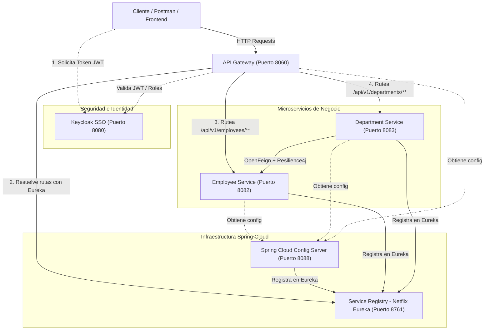

# TP2 - Ejercicio Nº 7: Arquitectura Microservicios / Cloud
## Punto d) Introducción Cloud

> **Materia:** Ingeniería del Software II (Año 2026)  
> **Guía Audiovisual:** [7) Introducción CLOUD - Curso Spring Cloud de Cero a Experto (DavinchiCoder)](https://www.youtube.com/watch?v=JJc1b5-mZDY&list=PL0W7WdoXu6O9VWgpDY10vEWt7G6xV9XTE)  
> **Repositorio de Referencia:** [https://github.com/David-DAM/spring-cloud-cero-a-experto](https://github.com/David-DAM/spring-cloud-cero-a-experto)  

---

## 1. Descripción del Ejercicio

El presente proyecto implementa un ecosistema completo de **Microservicios Cloud** desarrollado con **Java 21**, **Spring Boot 3.5.x** y **Spring Cloud 2025.0.x (Release Train)**, integrando los patrones fundamentales de arquitectura de sistemas distribuidos y seguridad con **OAuth2 / OpenID Connect (Keycloak)**.

El objetivo es comprender la transición y evolución de aplicaciones monolíticas hacia sistemas cloud distribuidos, tolerantes a fallos, escalables y con configuración y autenticación centralizada.

---

## 2. Diagrama de Arquitectura



---

## 3. Componentes del Ecosistema

### 1. `service-registry` (Eureka Server)
* **Puerto:** `8761`
* **Tecnología:** Spring Cloud Netflix Eureka Server (`spring-cloud-starter-netflix-eureka-server`).
* **Función:** Registro y descubrimiento dinámico de microservicios (*Service Discovery*). Cada instancia de los microservicios se registra automáticamente al iniciar y envía *heartbeats* periódicos para monitoreo de salud (*health check*). Permite desacoplar las direcciones IP y puertos físicos del consumo de los servicios.
* **Dashboard:** Accesible en `http://localhost:8761`.

### 2. `config-server` (Configuración Centralizada)
* **Puerto:** `8088`
* **Tecnología:** Spring Cloud Config Server (`spring-cloud-config-server`).
* **Función:** Almacena y distribuye centralizadamente los archivos de propiedades/YAML de todos los microservicios del ecosistema (`api-gateway.yml`, `department-service.yml`, `employee-service.yml`). Permite actualizar configuraciones dinámicamente mediante `@RefreshScope` y endpoints de Spring Boot Actuator (`/actuator/refresh`) sin recompilar ni reiniciar los servicios.

### 3. `api-gateway` (Puerta de Enlace / Spring Cloud Gateway)
* **Puerto:** `8060`
* **Tecnología:** Spring Cloud Gateway Server WebFlux (`spring-cloud-starter-gateway-server-webflux`), Spring Security OAuth2 Resource Server, Bucket4j & Caffeine.
* **Función:**
  - Punto de entrada unificado para clientes externos.
  - Enrutamiento dinámico mediante balanceador de carga integrado (`lb://employee-service`, `lb://department-service`).
  - Filtro global de auditoría (`RequestLoggingFilter`) que mide los tiempos de respuesta, método HTTP, URI y usuario autenticado.
  - Límite de tasa de peticiones (*Rate Limiting*) mediante Bucket4j (`RateLimitConfig`).
  - Autenticación reactiva basada en JWT emitido por Keycloak (`KeycloakJwtConverter`).

### 4. `employee-service` (Microservicio de Empleados)
* **Puerto:** `8082` (o dinámico)
* **Tecnología:** Spring Boot Web, Spring Cloud Config Client, Eureka Client, Spring Security OAuth2 Resource Server.
* **Función:**
  - Exposición de endpoints REST para la gestión de empleados (`/api/v1/employees`).
  - Operaciones de consulta, alta y asociación con departamentos.
  - Seguridad a nivel de endpoint validando tokens JWT de Keycloak.

### 5. `department-service` (Microservicio de Departamentos)
* **Puerto:** `8083` (o dinámico)
* **Tecnología:** Spring Boot Web, Spring Cloud OpenFeign, Resilience4j, Eureka Client, Spring Security OAuth2 Resource Server.
* **Función:**
  - Gestión de departamentos (`/api/v1/departments`).
  - Comunicación inter-servicios con `employee-service` mediante cliente declarativo **OpenFeign** (`EmployeeClient`).
  - Tolerancia a fallos y resiliencia con **Resilience4j** (Circuit Breaker, Retry, RateLimiter, TimeLimiter y Bulkhead) para evitar fallos en cascada cuando el servicio de empleados no responde.

### 6. `docker-config` y Keycloak SSO
* **Puerto:** `8080` (HTTP) / `9000` (Management)
* **Tecnología:** Docker Compose, Keycloak 26.x.
* **Función:** Proveedor de identidad (*Identity Provider - IdP*) OAuth2 / OpenID Connect con el *realm* preconfigurado `davinchicoder-realm.json`, clientes configurados, roles y usuarios para autenticar peticiones y generar tokens de acceso JWT.

---

## 4. Patrones de Diseño Cloud Implementados

| Patrón | Implementación en el Proyecto | Beneficio |
| :--- | :--- | :--- |
| **Service Discovery** | Netflix Eureka (`service-registry`) | Localización dinámica de servicios sin *hardcodear* IPs/puertos. |
| **Centralized Configuration** | Spring Cloud Config (`config-server`) | Gestión unificada y versionada de configuraciones por entorno. |
| **API Gateway Pattern** | Spring Cloud Gateway (`api-gateway`) | Punto único de entrada, seguridad perimetral, métricas y CORS. |
| **Client-Side Load Balancing** | Spring Cloud LoadBalancer (`lb://...`) | Distribución inteligente de carga entre réplicas de servicios. |
| **Circuit Breaker** | Resilience4j en `department-service` | Aislamiento y recuperación ante fallos de servicios dependientes. |
| **Declarative REST Client** | Spring Cloud OpenFeign (`EmployeeClient`) | Abstracción de llamadas HTTP entre microservicios mediante interfaces Java. |
| **Distributed Security** | OAuth2 Resource Server + Keycloak JWT | Autenticación y autorización basada en tokens sin estado (*stateless*). |

---

## 5. Guía de Ejecución Paso a Paso

### Prerrequisitos
* **Java JDK 21** o superior instalado.
* **Docker & Docker Compose** (opcional para levantar Keycloak si se requiere autenticación completa).
* Conexión a Internet para la descarga inicial de dependencias Maven.

### Orden de Inicio de los Servicios

Para garantizar que las dependencias de configuración y descubrimiento se resuelvan correctamente, se debe seguir este orden:

```
1. Keycloak (opcional/Docker) -> Puerto 8080
2. service-registry           -> Puerto 8761
3. config-server              -> Puerto 8088
4. employee-service           -> Puerto 8082
5. department-service         -> Puerto 8083
6. api-gateway                -> Puerto 8060
```

#### Paso 1: Iniciar Keycloak (Docker)
```powershell
docker compose up -d
```

#### Paso 2: Iniciar Service Registry (Eureka)
```powershell
cd service-registry
.\mvnw.cmd spring-boot:run
```
> Verificar en el navegador: [http://localhost:8761](http://localhost:8761)

#### Paso 3: Iniciar Config Server
```powershell
cd ..\config-server
.\mvnw.cmd spring-boot:run
```
> Verificar configuraciones servidas: [http://localhost:8088/employee-service/default](http://localhost:8088/employee-service/default)

#### Paso 4: Iniciar Employee Service
```powershell
cd ..\employee-service
.\mvnw.cmd spring-boot:run
```

#### Paso 5: Iniciar Department Service
```powershell
cd ..\department-service
.\mvnw.cmd spring-boot:run
```

#### Paso 6: Iniciar API Gateway
```powershell
cd ..\api-gateway
.\mvnw.cmd spring-boot:run
```

---

## 6. Pruebas y Colección Postman

El proyecto incluye el archivo `postman_collection.json` con todas las peticiones listas para importar en Postman:

1. **Obtención de Token OAuth2:** Petición POST a Keycloak para autenticar al usuario y recibir el `access_token` JWT.
2. **Consultas a través de API Gateway:**
   - `GET http://localhost:8060/api/v1/employees`
   - `POST http://localhost:8060/api/v1/employees`
   - `GET http://localhost:8060/api/v1/departments`
   - `GET http://localhost:8060/api/v1/departments/{id}/with-employees` (Invoca la comunicación OpenFeign inter-microservicios).
3. **Prueba de Circuit Breaker:** Al apagar `employee-service`, la llamada a `department-service` activa el mecanismo de *fallback* o gestión de error controlado de Resilience4j.
